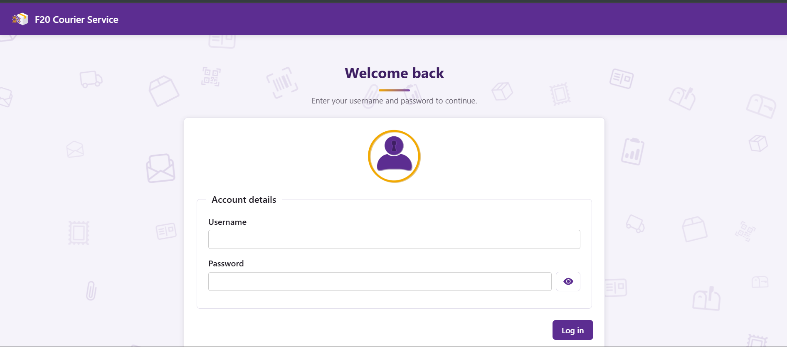
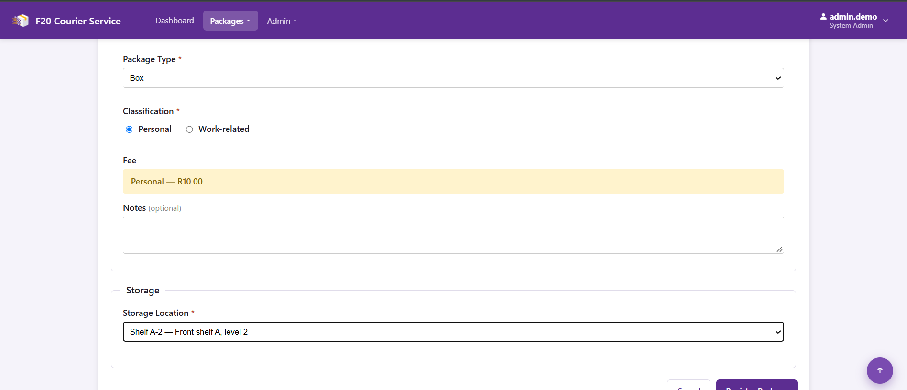
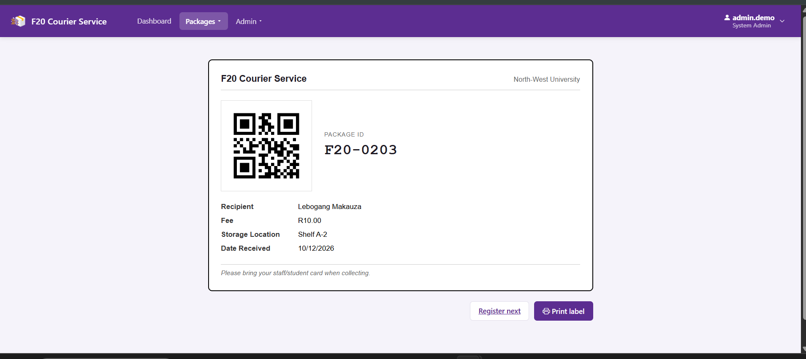
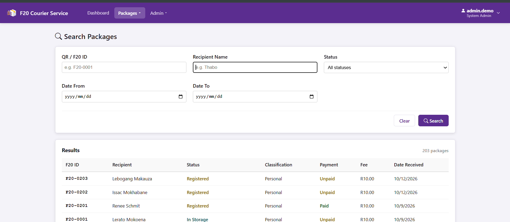
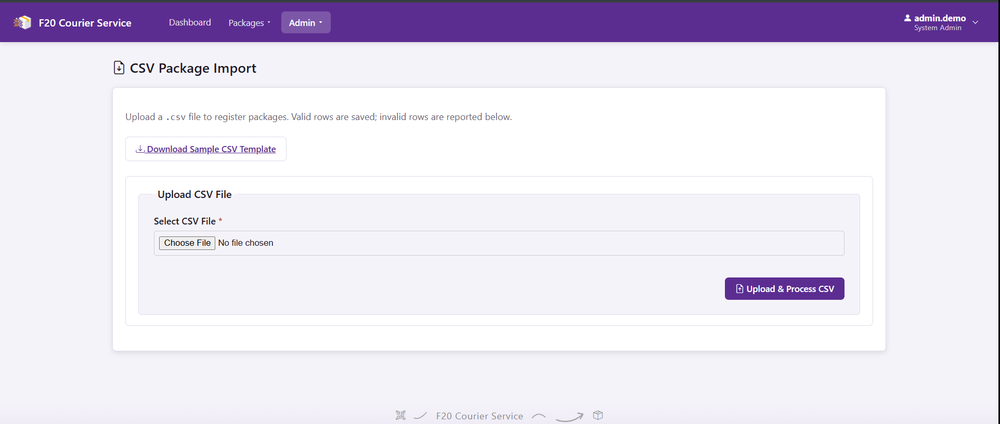
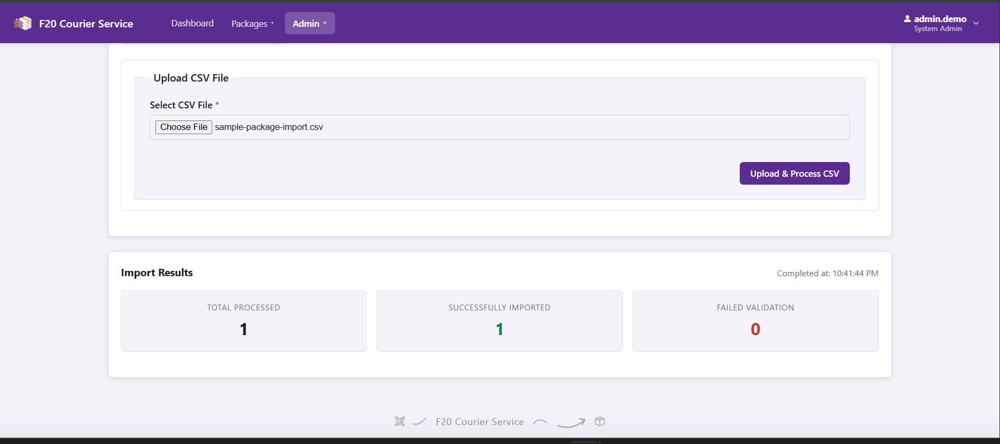
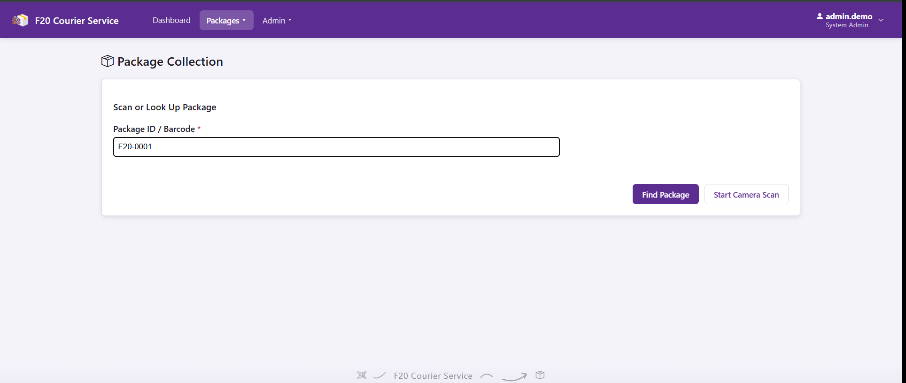
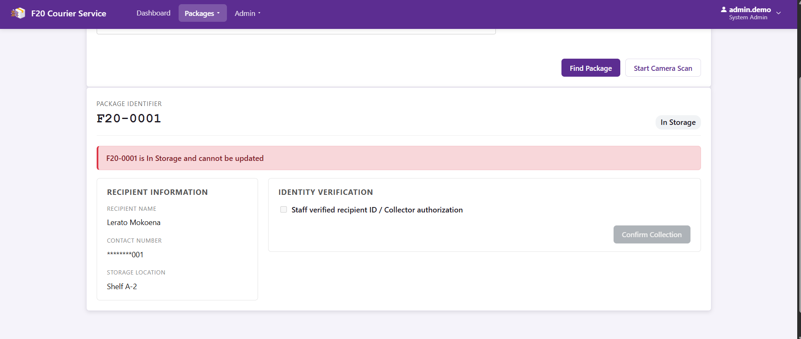
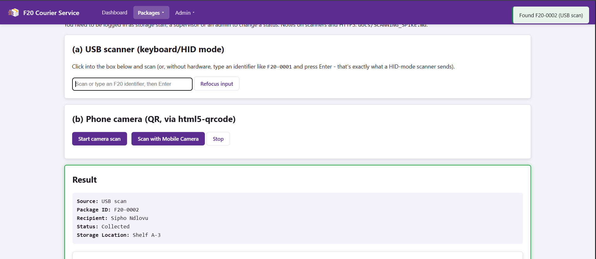
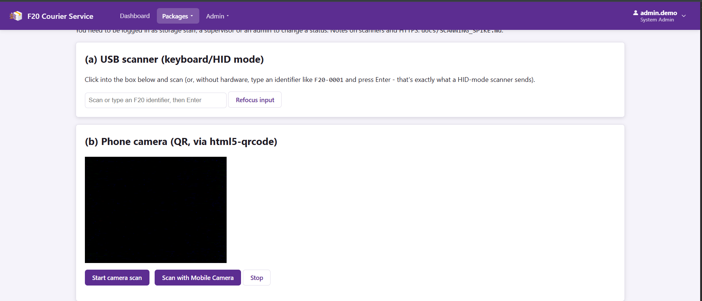

# F20 Courier Service — User Manual

A staff guide to the Courier Service Management and Tracking System at North-West University's F20 facility.

---

## About This Manual

This manual covers the day-to-day workflows for F20 courier service staff:

- **Logging in** — for every role
- **Registering a package** — Intake Clerk
- **Searching for a package** — all roles
- **Importing packages from CSV** — Supervisor / SystemAdmin
- **Collecting a package** — Collection Staff
- **Scanning a package** — Storage / Collection Staff 
- **Updating package status** — Storage Staff *(pending)*

### Demo Logins

For testing and demonstration, the following accounts are seeded in the database:

| Username | Role | Password |
|:---|:---|:---|
| `admin.demo` | SystemAdmin | `Demo@2026!` |
| `intake.demo` | IntakeClerk | `Demo@2026!` |
| `storage.demo` | StorageStaff | `Demo@2026!` |
| `collection.demo` | CollectionStaff | `Demo@2026!` |
| `supervisor.demo` | Supervisor | `Demo@2026!` |

> **Mock mode:** During development, frontend screens can run against mock data instead of the real backend. In the browser console, run `CourierApp.config.setMockMode(true)` to enable and `false` to disable. Production use always runs with mock mode off.

---

## 1. Logging In

**Who:** All staff.

**Prerequisites:** You must have a user account created by a SystemAdmin.

### Steps

1. Open the application in your browser.
2. You'll be redirected to the login page.
3. Enter your **username or email** and **password**.
4. Click **Log in**.

On success, you'll land on the Dashboard and your name and role will appear in the top-right corner.

### If Login Fails

- **"Invalid username or password"** — Check your credentials and try again. Both fields are case-sensitive.
- **"You need to log in to do this"** when navigating to other pages — Your session has expired or wasn't set. Log in again.

### Logging Out

Click your name in the top-right corner and select **Log out**.

---

## 2. Registering a Package

**Who:** Intake Clerk, Supervisor, SystemAdmin.

**Prerequisites:** You must be logged in. You'll need the recipient's details and the package in hand.

### Steps

1. From the top navigation, click **Packages → Register**.
2. Fill in the form. Fields are grouped into three sections that match the manual intake process:

   **Recipient Details**
   - Full Name *(required)*
   - Staff / Student Number *(required)*
   - Email *(required)*
   - Phone *(required)*
   - Department *(optional)*

   **Package Details**
   - Sender Name *(required)*
   - Package Type *(required — Envelope / Box / Parcel / Other)*
   - Classification *(required — Personal or Work-related)*
   - Notes *(optional)*

   **Storage**
   - Storage Location *(required — select from the dropdown)*

3. **As soon as you select Personal or Work-related, the fee appears:**
   - **Personal** → **R10.00**
   - **Work-related** → **R0.00**

4. Click **Register Package**.

On success you'll see a green confirmation toast and be redirected to the printable label view for the new package.

### Printing the Label

The label view shows the F20 identifier as a QR code plus minimal package details, ready for printing and attaching to the package.

1. Click **Print label** to open your browser's print dialog.
2. Print and attach the label to the package.
3. Click **Register next** (or press **Alt + R**) to return to the registration form for the next package.

### If Something Goes Wrong

- **Validation errors** appear inline below the offending field in red. Fix and resubmit.
- **"Please fix the errors above"** — One or more required fields are missing or invalid.

---

## 3. Searching for a Package

**Who:** All staff.

**Prerequisites:** Logged in.

### Steps

1. From the top navigation, click **Packages → Search**.
2. Fill in any combination of filters:
   - **QR / F20 ID** — e.g. `F20-0001`
   - **Recipient Name** — partial match, e.g. `Thabo`
   - **Status** — Registered / In Storage / Ready for Collection / Collected
   - **Date From** and **Date To**
3. Click **Search**.

Results appear in a table with columns: **F20 ID**, Recipient, Status, Classification, **Payment**, Fee, Date Received.

### Paging

- **Next** and **Previous** buttons at the bottom of the table move between pages (10 packages per page).
- The current page indicator is shown between the buttons.

### Viewing a Package's Details

Click any row to open the package detail page.

### Clearing Filters

Click **Clear** to reset all filters and show all packages.

---

## 4. Importing Packages from CSV

**Who:** Supervisor, SystemAdmin.

**Prerequisites:** Logged in. A CSV file following the agreed format.

### Steps

1. From the top navigation, click **Admin → Import** (or **Import** depending on your role).
2. Click **Choose file** and select your CSV.
3. Click **Upload**.

The system validates the file row by row and shows a summary:

- **Imported Count** — number of packages successfully created.
- **Failed Rows** — list of rows that failed validation, with the reason (e.g. *"Row 5: Missing recipient email address"*).

### If the File Is Rejected

If the CSV structure itself is invalid (wrong columns, missing header), the whole file is rejected and no rows are imported. Fix the format and try again.

---

## 5. Collecting a Package

**Who:** Collection Staff, Supervisor, SystemAdmin.

**Prerequisites:** Logged in. The recipient is present to collect their package.

### Steps

1. From the top navigation, click **Packages → Collection** (or **Collect package** from the Dashboard shortcut).
2. Scan the package's QR code, or type the **F20 identifier** into the lookup field (e.g. `F20-0001`).

3. Click **Find Package**.
4. Verify the recipient's identity against the package details shown.
5. Confirm the collection (and record payment if the package is Personal and unpaid).

On success:
- The package status updates to **Collected**.
- The recipient receives a collection confirmation notification (email and SMS).
- The transaction is logged with your user ID and the current time.

---

## 6. Scanning a Package

**Who:** Storage Staff, Collection Staff, Supervisor, SystemAdmin.

**Prerequisites:** Logged in. USB barcode scanner or a device with a camera.

### Overview

The Scan page provides two lookup methods. Both perform the same lookup (`GET /api/packages/scan/{f20Identifier}`) and return the package record.

### (a) USB Scanner (Keyboard / HID Mode)

1. Plug in the USB scanner and click into the input box.
2. Scan the package's F20 QR code. The scanner "types" the identifier and presses Enter automatically.
3. The package record loads below.

If you don't have a scanner attached, you can type an identifier manually (e.g. `F20-0001`) and press **Enter** — that's exactly what a HID-mode scanner sends.

### (b) Phone Camera QR Scan

1. Click **Start camera scan**.
2. Grant camera permission when prompted.
3. Point the camera at the package's QR code.
4. The lookup runs automatically on a successful read.

> **Note:** Camera scanning requires HTTPS, or `http://localhost`. On other origins the camera will not start — use the USB scanner instead.

---

## 7. Updating Package Status

**Who:** Storage Staff, Supervisor, SystemAdmin.

> **Coming soon:** The dedicated status update interface is in progress (T35). In the current release, package status is updated through the scanning workflow once T35 is merged.

### Planned Workflow

1. Scan the package.
2. Choose the next status from the valid transitions for the current state.
3. Confirm the storage location if applicable.
4. Click **Confirm update**.

The system will:
- Validate the transition (invalid transitions return an error).
- Update the package record.
- Write an audit entry.
- Add an entry to the package's status timeline.

---

## Appendix A — Package Lifecycle

A package moves through the following statuses:

| Status | Meaning |
|:---|:---|
| **Registered** | Record created, awaiting storage assignment |
| **InStorage** | Placed on a shelf / in a storage area |
| **ReadyForCollection** | Recipient has been notified, awaiting pickup |
| **Collected** | Recipient has collected the package |

## Appendix B — Payment Status

Each package has a payment status:

| Status | Meaning |
|:---|:---|
| **Unpaid** | Default for personal packages (fee R10.00) |
| **Paid** | Fee has been collected |
| **Exempt** | No fee applies (default for work-related packages) |

Payment status is shown on the Search results table and on the package Detail page. Authorised roles can update it from the Detail page using the dropdown and **Save** button.

## Appendix C — Troubleshooting

| Symptom | Likely Cause / Fix |
|:---|:---|
| "You need to log in to do this" | Session expired — log in again |
| Storage dropdown won't load | Backend unavailable, or (in development) mock mode is off and the fixtures endpoint is unreachable |
| "Could not load package details" | Check the F20 identifier is correct |
| Camera scan won't start | The page isn't served over HTTPS or localhost |
| Print output contains the site header | Your browser has cached an old stylesheet — hard refresh with Ctrl+F5 |