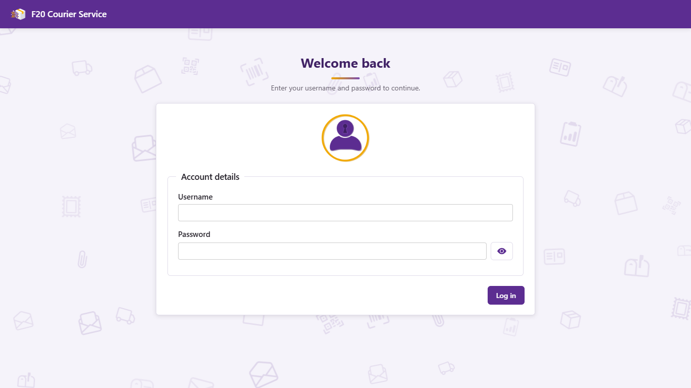
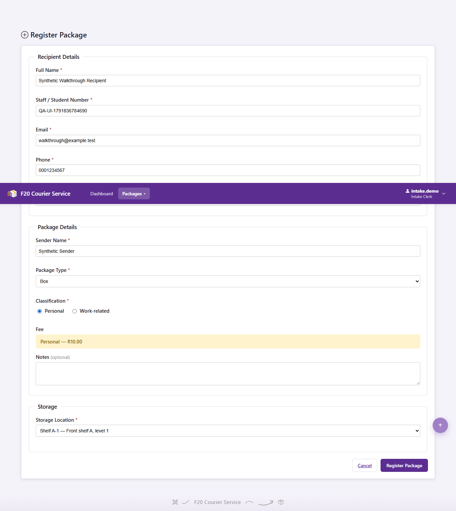

# Staff user guide

This guide covers the courier site's five staff roles. The screenshots below were captured from the live site with mock mode disabled and synthetic data on 2026-10-12. Physical phone/scanner verification is tracked separately in #56.

## Sign in and navigation

Open the address supplied by your administrator, enter your staff username and password, and select Login. The dashboard shows the signed-in role. Use the Packages and Admin menus for the operations available to that role. Use the user menu to log out when finished, especially on a shared workstation. If your session expires, sign in again before repeating the operation.

| Role | Main tasks |
| --- | --- |
| Intake Clerk | Register packages, print labels, search and inspect details. |
| Storage Staff | Scan packages and move them into storage or mark them ready for collection. |
| Collection Staff | Look up ready packages, verify identity and confirm collection; record payment where permitted. |
| Supervisor | Intake, storage and collection tasks; bulk import, reports and audit viewer when deployed. |
| System Admin | Supervisor tasks plus user management and storage-location administration. |

Missing or forbidden menu items are intentional. Contact an administrator if your account has the wrong role; another person's login should not be used to bypass it.

Dashboard examples: [Intake](screenshots/dashboard-intake.png), [Storage](screenshots/dashboard-storage.png), [Collection](screenshots/dashboard-collection.png), [Supervisor](screenshots/dashboard-supervisor.png), [System Admin](screenshots/dashboard-admin.png).

## Register and print a label

1. Open Packages > Register package.
2. Enter the recipient's name, staff/student number, email and phone. Department is optional.
3. Enter the sender and package type; choose Personal or Work-related and a storage location. Add notes if necessary.
4. Check the displayed fee and select Register Package. Resolve any highlighted errors before submitting again. If fees cannot load, reload the page; do not assume a default amount.
5. The label page opens for the saved package. Print the QR label and attach it securely. Record the F20 identifier if printing fails, then find the saved package through Search rather than registering it again.

The QR holds the package identifier, not recipient details. Label generation is available to Intake Clerk, Supervisor and System Admin. Configured fees apply to new registrations; previous packages retain their saved fee.

[Saved QR label](screenshots/label.png).

## Search and inspect a package

Open Packages > Search packages. Enter the identifier or supported recipient search fields, apply filters and open a result. Details show status, location, payment and history. Use the F20 identifier to distinguish packages for recipients with similar names. An unknown identifier should show a friendly error.

[Search screen](screenshots/search.png) and [saved payment and lifecycle details](screenshots/details-payment.png).

## Scan and store

Open Packages > Scan. Click the scanner input if it has lost focus. A USB scanner types the identifier and submits with Enter; you can also type the identifier yourself. On a phone, open the HTTPS site and allow camera access when prompted.

Look up the package before changing it. Select the available next status and, where required, the storage location. The lifecycle is Registered -> In Storage -> Ready for Collection -> Collected. Skipping a stage or moving backwards is rejected. Mark a package ready only when it can be collected; the system queues the recipient notification.

## Verify identity and collect

1. Open Packages > Collection and scan or enter the F20 identifier.
2. Confirm that the package is Ready for Collection.
3. Verify the recipient's identity using the required staff/student identification and the displayed information.
4. Select the verifier required by the form and confirm collection. Cancel if any detail is wrong.
5. Check the success message and updated status/history. A package that is not ready cannot be collected; an already collected package must not be handed out again.

If payment is recorded separately, update its Paid/Unpaid/Exempt status on the package detail page using an authorized account and confirm that it survives a reload.

## Bulk import

Supervisor/System Admin: open Admin > CSV import and download the site's sample template. Preserve its header names and supply synthetic data during testing. Select the completed CSV and upload it once. Review the saved count and failed row numbers/reasons. Correct failed rows without uploading already successful records again. An ambiguous network failure needs a package search before retrying.

Mock mode cannot save CSV imports. Turn it off before importing into the real system.

## Reports and audit

Supervisor/System Admin: open Admin > Reports, choose dates and filters, then apply or refresh. Totals concern packages registered in the selected date range and their current status/payment, not all transactions during that range. Select an outstanding package identifier to inspect it. The outstanding list shows the oldest 50 matching packages, not every matching record.

The Audit log menu opens the read-only viewer. Search, action and UTC date filters narrow the records; Previous/Next retains those filters. Other roles cannot access the viewer.

## User administration

System Admin: open Admin > User Management. Search/filter accounts by role or status. Add User opens the creation panel; fill every required field and choose a role. Cancel clears the entered fields. A new password must meet the rules shown by validation.

Choose another user's role or Activate/Deactivate and review the confirmation dialog. Cancel makes no change. Do not repeat-click while a request is pending. Your own role and activation cannot be changed from your row. Deactivation blocks future login; use the correct account before confirming.

## Problems and recovery

| Symptom | Action |
| --- | --- |
| Login/session error | Sign in again; check the username and account status. |
| Access Denied | Check your role with the administrator. |
| Unknown code | Verify the printed F20 identifier and use Search. |
| Camera unavailable | Use HTTPS, allow camera permission and ask the administrator to check phone access/certificate trust. Use USB or manual lookup meanwhile. |
| Database unavailable | Retry after the service is restored. Do not repeatedly submit registrations/imports. |
| Email delayed | Check package status first; ask an authorized staff member to inspect notification attempts. Status work should continue even if delivery fails. |
| Charts unavailable | Read report totals/table and report the browser error to the administrator. |

## Screen examples

These captures show the integrated candidate, including the audit viewer #119. They establish browser workflows, not physical printing or camera tests.

| Screenshot | Status |
| --- | --- |
| Login and dashboard for each role | Captured above. |
| Registration with live fee and saved label | Captured above; physical printing is not verified. |
| Keyboard scan and status change | [Scan and status](screenshots/scan-status.png); camera permission and USB hardware require #56. |
| Identity and collection confirmation | [Confirmation dialog](screenshots/collection-confirmation.png); Cancel leaves the package ready. |
| Search/details/payment and import results | [CSV results: two saved, one invalid](screenshots/import-results.png). |
| Reports and audit | [Reports](screenshots/reports.png), [narrow reports](screenshots/reports-narrow.png), [audit viewer](screenshots/audit.png). |
| User administration | [Users](screenshots/users.png); changing roles or activation asks for confirmation. |

See [ROLE_TEST_SCRIPT.md](ROLE_TEST_SCRIPT.md) for the acceptance checks and [TEST_RESULTS.md](TEST_RESULTS.md) for recorded automated evidence.
